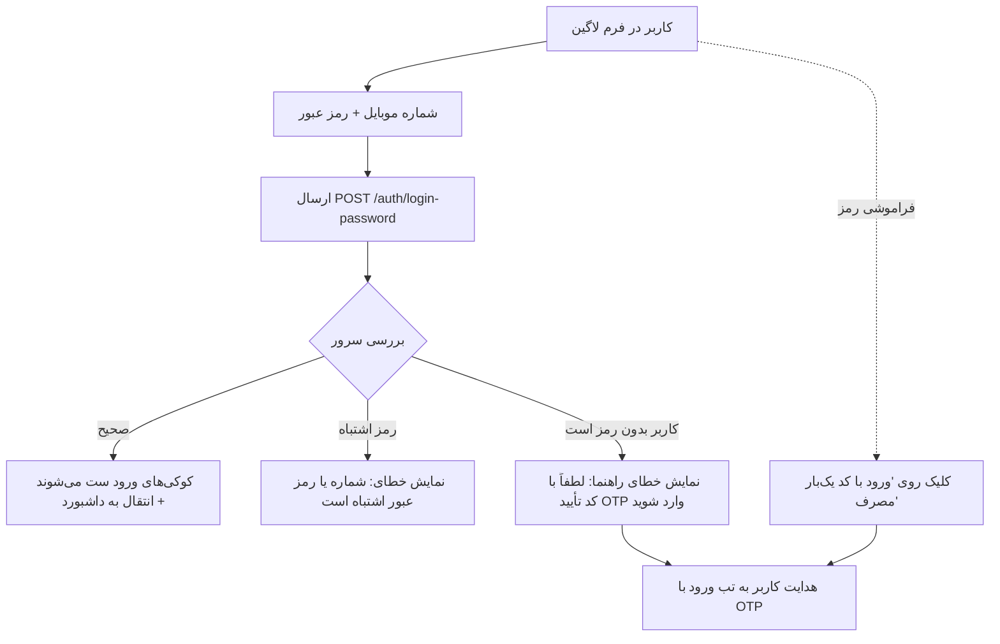
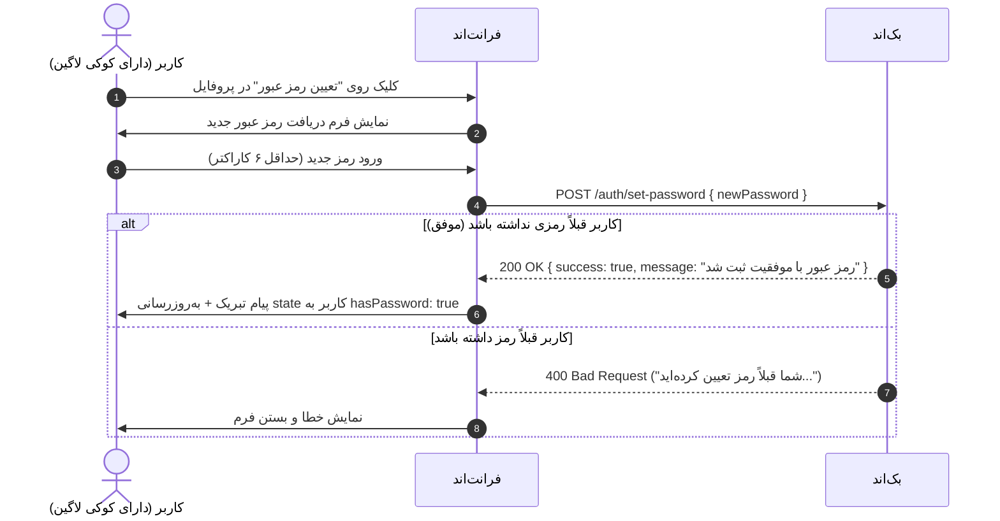
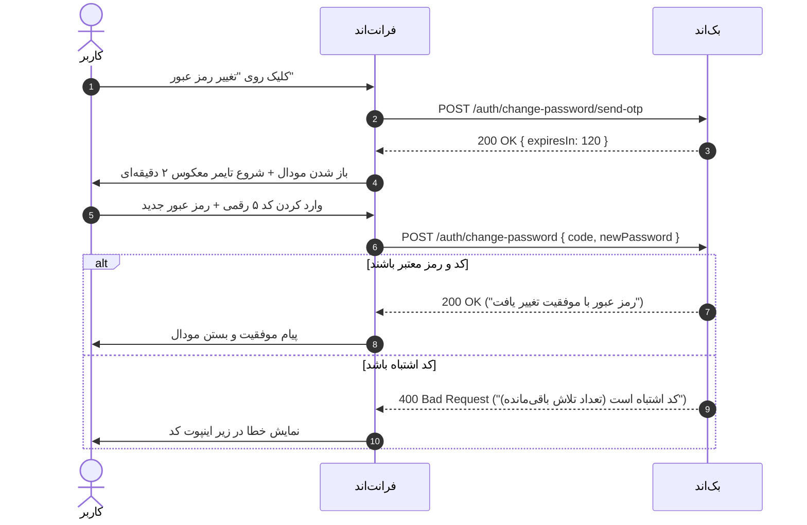

# راهنمای جامع بخش رمز عبور برای تیم فرانت‌اند (Frontend Integration Guide)

این سند جهت توضیح دقیق سناریوهای **ورود با رمز عبور**، **تعیین رمز عبور اولیه** و **تغییر امن رمز عبور با تأیید پیامکی** در فرانت‌اند (React / Next.js / Vue) تدوین شده است.

---

## ۱. اصول و پیش‌نیازهای ارتباط فرانت‌اند با بک‌اند

> **نکته بسیار مهم: مکانیزم احراز هویت بر پایه کوکی‌های امن (HttpOnly & Signed Cookies) است:**
> - فرانت‌اند نیازی به ذخیره‌سازی توکن در `localStorage` یا ارسال هدر `Authorization: Bearer` **ندارد**.
> - در کلیه درخواست‌های کتابخانه‌های ارتباطی (مانند `axios` یا `fetch`)، پارامتر زیر باید **حتماً** فعال باشد:
>   - در **Axios:** `axios.defaults.withCredentials = true;`
>   - در **Fetch:** `fetch(url, { credentials: 'include', ... })`

---

## ۲. تشخیص وضعیت کاربر در فرانت‌اند (`hasPassword`)

پاسخ اندپوینت‌های `/auth/me`، `/auth/verify-otp` و `/auth/login-password` همواره شیء کاربر را همراه با فیلد باینری `hasPassword` بازمی‌گردانند:

```json
{
  "success": true,
  "data": {
    "user": {
      "id": "cmvscl1ya0001xcufxzrfsy24",
      "phone": "09121234567",
      "hasPassword": false,
      "createdAt": "2026-10-28T16:47:44.000Z"
    }
  }
}
```

### منطق نمایش UI بر اساس `hasPassword`:
- **اگر `hasPassword === false`:**
  - کاربر با کد OTP ثبت‌نام کرده و هنوز هیچ رمزی ندارد.
  - در بخش تنظیمات یا امنیت پروفایل، دکمه **«تعیین رمز عبور»** نمایش داده می‌شود (فراخوانی اندپوینت `POST /auth/set-password`).
- **اگر `hasPassword === true`:**
  - کاربر رمز عبور فعال دارد.
  - در پروفایل دکمه **«تغییر رمز عبور»** نمایش داده می‌شود (فراخوانی فلو تغییر رمز با کد تأیید).

---

## ۳. سناریوی ۱: ورود با رمز عبور (`POST /auth/login-password`)

### شرح عملکرد و جریان کاربر (UX Flow):
کاربر در صفحه ورود به جای دریافت پیامک، شماره موبایل و رمز عبور خود را وارد می‌کند.



### اطلاعات اندپوینت:
- **مسیر:** `POST ${BASE_URL}/auth/login-password`
- **دسترسی:** عمومی (Public)
- **بدنه درخواست (Request Body):**
  ```json
  {
    "phone": "09121234567",
    "password": "MySecretPassword123"
  }
  ```
  *(نکته: ارقام فارسی کیبورد و فاصله‌ها به طور خودکار توسط سرور نرمال‌سازی می‌شوند).*

### نمونه پاسخ‌های سرور:
- **موفقیت (HTTP 200):**
  ```json
  {
    "success": true,
    "message": "ورود با رمز عبور با موفقیت انجام شد",
    "data": {
      "user": {
        "id": "cmvscl1ya0001xcufxzrfsy24",
        "phone": "09121234567",
        "hasPassword": true,
        "createdAt": "2026-10-28T16:47:44.000Z"
      }
    }
  }
  ```
- **خطا در صورت عدم وجود رمز برای کاربر (HTTP 400):**
  ```json
  {
    "success": false,
    "statusCode": 400,
    "message": "برای این حساب کاربری هنوز رمز عبوری تعیین نشده است. لطفاً از طریق کد تأیید (OTP) وارد شوید"
  }
  ```

---

## ۴. سناریوی ۲: تعیین رمز عبور اول (`POST /auth/set-password`)

### شرح عملکرد و جریان کاربر (UX Flow):
مخصوص کاربری که لاگین است و `hasPassword: false` می‌باشد. کاربر بدون نیاز به وارد کردن رمز قدیمی، مستقیماً رمز جدید را تعیین می‌کند.



### اطلاعات اندپوینت:
- **مسیر:** `POST ${BASE_URL}/auth/set-password`
- **دسترسی:** نیازمند لاگین 🔒 (`credentials: 'include'`)
- **پیش‌شرط:** کاربر باید لاگین باشد و فاقد رمز عبور باشد (`hasPassword === false`).
- **بدنه درخواست (Request Body):**
  ```json
  {
    "newPassword": "MyNewPassword123"
  }
  ```
- **پاسخ موفق (HTTP 200):**
  ```json
  {
    "success": true,
    "message": "رمز عبور با موفقیت ذخیره شد"
  }
  ```

---

## ۵. سناریوی ۳: تغییر رمز عبور با تأیید پیامکی (`Change Password Flow`)

### شرح عملکرد و جریان کاربر (UX Flow):
مخصوص کاربری که لاگین است و قصد تغییر رمز دارد (`hasPassword: true`). جهت امنیت حداکثری حساب، فرآیند در ۲ مرحله با کد OTP انجام می‌شود:



### گام اول: درخواست ارسال کد تأیید (`POST /auth/change-password/send-otp`)
- **مسیر:** `POST ${BASE_URL}/auth/change-password/send-otp`
- **دسترسی:** نیازمند لاگین 🔒 (`credentials: 'include'`)
- **بدنه درخواست:** _بدون ورودی (شماره موبایل مستقیماً از نشست امن خوانده می‌شود)_.
- **پاسخ موفق (HTTP 200):**
  ```json
  {
    "success": true,
    "message": "کد تأیید برای تغییر رمز عبور ارسال شد",
    "data": {
      "expiresIn": 120
    }
  }
  ```

### گام دوم: تایید کد و ذخیره رمز جدید (`POST /auth/change-password`)
- **مسیر:** `POST ${BASE_URL}/auth/change-password`
- **دسترسی:** نیازمند لاگین 🔒 (`credentials: 'include'`)
- **بدنه درخواست (Request Body):**
  ```json
  {
    "code": "54321",
    "newPassword": "BrandNewSecurePassword123"
  }
  ```
- **پاسخ موفق (HTTP 200):**
  ```json
  {
    "success": true,
    "message": "رمز عبور با موفقیت تغییر یافت"
  }
  ```

---

## ۶. جدول خلاصه ارجاع سریع برای فرانت‌اند

| سناریوی فرانت‌اند | اندپوینت هدف | بدنه ارسالی (Body) | وضعیت احراز هویت |
| :--- | :--- | :--- | :---: |
| **ورود با رمز** | `POST /auth/login-password` | `{ phone, password }` | بدون نشست (مهمان) |
| **تعیین رمز اول** | `POST /auth/set-password` | `{ newPassword }` | لاگین‌شده (`hasPassword: false`) |
| **درخواست کد تغییر رمز** | `POST /auth/change-password/send-otp` | _(خالی)_ | لاگین‌شده (`hasPassword: true`) |
| **ثبت نهایی تغییر رمز** | `POST /auth/change-password` | `{ code, newPassword }` | لاگین‌شده (`hasPassword: true`) |

---

## ۷. ساختار خطاهای اعتبارسنجی ارسالی به فرانت‌اند (Zod Validation)

در صورتی که فرمت داده‌ها نامعتبر باشد (مثلاً شماره موبایل ناقص یا رمز کمتر از ۶ کاراکتر باشد)، پاسخ با کد وضعیت `400` و ساختار استاندارد زیر بازمی‌گردد:

```json
{
  "success": false,
  "statusCode": 400,
  "message": "اطلاعات وارد شده معتبر نمی‌باشد",
  "errors": [
    {
      "field": "newPassword",
      "code": "too_small",
      "message": "رمز عبور باید حداقل ۶ کاراکتر باشد"
    }
  ]
}
```
فرانت‌اند می‌تواند مستقیماً از آرایه `errors` برای نمایش ارور زیر فیلد مربوطه در فرم استفاده کند.

---

## ۸. ساختار یکپارچه پاسخ درخواست کد تایید و مدیریت ارسال زودهنگام (HTTP 200)

پاسخ اندپوینت‌های درخواست کد تایید (`POST /auth/send-otp` و `POST /auth/change-password/send-otp`) در هر دو حالت (درخواست بار اول یا درخواست مجدد قبل از اتمام ۲ دقیقه) **کاملاً با وضعیت `HTTP 200` و ساختار یکسان** بازگردانده می‌شود تا کنترل وضعیت در فرانت‌اند بسیار ساده و روان باشد:

### حالت اول: درخواست بار اول (یا پس از انقضای ۲ دقیقه)
کد جدید تولید شده و مهلت ۱۲۰ ثانیه‌ای تنظیم می‌شود:
```json
{
  "success": true,
  "message": "کد تأیید برای ورود ارسال شد",
  "data": {
    "isNewUser": false,
    "expiresIn": 120
  }
}
```

### حالت دوم: درخواست مجدد قبل از اتمام ۲ دقیقه
کد قبلی معتبر باقی مانده، زمان باقی‌مانده در `expiresIn` بازگشته و پیام اطلاع‌رسانی می‌شود:
```json
{
  "success": true,
  "message": "کد هنوز معتبر است",
  "data": {
    "isNewUser": false,
    "expiresIn": 85
  }
}
```

### نمونه کد یکپارچه‌سازی تایمر در فرانت‌اند (React / Axios):

```typescript
try {
  const { data } = await axios.post("/auth/send-otp", { phone });

  // همگام‌سازی تایمر بر اساس زمان بازگشتی سرور (120 ثانیه یا ثانیه‌های باقی‌مانده)
  startCountdown(data.data.expiresIn);

  // نمایش پیام سرور به کاربر ("کد تأیید برای ورود ارسال شد" یا "کد هنوز معتبر است")
  toast.info(data.message);
} catch (error: any) {
  // تنها خطاهای اعتبارسنجی واقعی مانند فرمت نادرست موبایل به catch می‌آیند
  toast.error(error.response?.data?.message || "خطایی در برقراری ارتباط رخ داد");
}
```

